# Boîtier timecode LTC sans fil TX/RX : conception et simulations

Révision A, 4 novembre 2026. Tous les chiffres de ce rapport sortent des fichiers `sim/*/resultats.json`, produits par les bancs ngspice et Python du dossier `sim/`.

## 0. Résumé

**Verdict de faisabilité : l'architecture demandée est réalisable et tient le budget** (environ 23 € de composants par boîtier hors port, voir §8). Trois points du cahier des charges sont corrigés en cours de route :

1. **La commutation de la BNC est faite par l'inverseur TX/RX lui-même** (inverseur à glissière 2 circuits). Un pôle aiguille physiquement l'âme de la BNC, l'autre informe l'ESP32. Un commutateur analogique 3,3 V ne laisse pas passer les ±9 V qu'accepte une entrée Sony, et une simple commutation logicielle échoue (démontré en simulation C4).
2. **La sortie utilise un amplificateur opérationnel** (TLV9061) et non un transistor BC547. Le suiveur attaque 75 Ω proprement, avec des fronts mis en forme à 24 µs comme le demande la norme. Un émetteur suiveur NPN sous 3,3 V ne descend pas symétriquement sur 75 Ω sans courant de repos élevé.
3. **L'entrée utilise un comparateur TLV3201**, rail à rail et push-pull. Le LM393 a un mode commun limité à VCC − 1,5 V et une sortie à collecteur ouvert : sous 3,3 V, il serait polarisé presque en bord de plage.

Ce qui est **démontré par simulation** :

| Sous-circuit | Résultat clé | Simulation |
|---|---|---|
| Entrée LTC | Décodage exact de 0,3 à 18 Vcc, sources de 50 Ω à 1 kΩ, 24, 25, 29,97 DF et 30 i/s, avec bruit, ronflement, fronts lents ou carrés. Seuil de décodage 0,09 Vcc au pire offset. | A1 à A9 |
| Sortie LTC | 1,98 Vcc à vide, 0,98 Vcc sous 75 Ω, Zout = 76 Ω, fronts de 23,5 à 24 µs (norme 25 ± 5 µs). Décodée sur toutes les charges de 75 Ω à 1 MΩ et à 100 m de câble. | B1 à B9 |
| Commutation | Isolement de −128 dB à 2,4 kHz en TX. En TX, seul le LTC externe est décodé, même si la sortie est active par erreur. | C1 à C5 |
| Alimentation | 3,3 V ≥ 3,0 V pendant une pointe de 500 mA tant que la f.é.m. de la batterie reste ≥ 3,3 V (régulateur typique) ou ≥ 3,4 V (régulateur au pire). Autonomie estimée de 18 à 20 h. | D1 à D9 |
| Synchronisation | Écart RX/maître de 117 µs en moyenne (0,3 % d'image), 200 µs au pire après 30 s de coupure radio, aucun saut d'image. Modèle comportemental. | E |

Ce qui **n'est pas démontré** et doit être mesuré sur maquette : le comportement réel de la radio (latence et gigue d'ESP-NOW), l'acceptation du signal par chaque caméra, la CEM et les décharges électrostatiques, et le firmware lui-même (§9 et §10).

## 1. Exigences relevées

### 1.1 Le signal LTC

- Trame de 80 bits par image, codage biphase-mark : une transition à chaque frontière de bit et une transition supplémentaire au milieu d'un bit « 1 ». Le signal est donc **insensible à la polarité** et sans composante continue sur une trame (bit de correction de polarité). Mot de synchro sur les bits 64 à 79 ([Wikipedia, Linear timecode](https://en.wikipedia.org/wiki/Linear_timecode)).
- Fréquences : de 960 Hz (bits 0 à 24 i/s) à 2400 Hz (bits 1 à 30 i/s). Le demi-bit le plus court dure 208,3 µs.
- Fronts : **25 µs ± 5 µs** (10 à 90 %), ce qui correspond à un premier ordre de constante 11,5 µs ([US5543976A](https://patents.google.com/patent/US5543976), [Phil Rees](https://www.philrees.co.uk/articles/timecode.htm)).
- L'amplitude normalisée SMPTE n'a pas pu être lue dans la norme elle-même (payante). On se cale donc sur les équipements.

### 1.2 Les équipements

| Équipement | Entrée TC | Sortie TC | Source |
|---|---|---|---|
| Sony XDCAM (relevé sur PXW-Z450 et PMW-150) | BNC, 0,5 à 18 Vcc, 10 kΩ | BNC, 1,0 Vcc, 50 Ω | manuels Sony via manualslib |
| Sony FX6 | BNC TC IN/OUT commutable | idem | [fiche Sony FX6](https://www.sony-mea.com/en/interchangeable-lens-cameras/products/ilme-fx6/spec) : niveaux non publiés |
| Sony FS5, Z150, Z200 | BNC TC IN/OUT | idem | niveaux **non vérifiés**, supposés identiques à la famille XDCAM |
| Sony FX3 + VMC-BNCM1 | BNC vers prise Multi, **entrée seulement**, firmware ≥ 2.00 | aucune | [Newsshooter](https://www.newsshooter.com/2022/07/14/how-timecode-sync-works-with-the-sony-fx3/) |
| Sound Devices MixPre-3 II / 6 II | jack 3,5 mm Aux In, **0,3 à 3,0 Vcc, 20 kΩ** | jack 3,5 mm, **3,0 Vcc, 1 kΩ** | [fiche MixPre-3 II](https://www.sounddevices.com/mixpre-3-ii-specifications/) |
| Blackmagic Pocket 6K Pro | LTC lu sur l'entrée audio 3,5 mm, niveau micro | aucune | [RØDE](https://rode.com/about/news-info/using-timecode-on-the-blackmagic-pocket-4k-6k-6k-pro-with-wireless-pro), [Ambient](https://faq.ambient.de/hc/en-001/articles/4415083061650-Timecode-Cable-Guide) |

On en déduit les cibles suivantes.

- **Entrée** : accepter au moins 0,3 à 18 Vcc avec une impédance d'au moins 10 kΩ, sur des sources de 50 Ω (Sony) à 1 kΩ (MixPre).
- **Sortie** : environ 2 Vcc à vide, ce qui reste sous le maximum de 3 Vcc du MixPre et largement au-dessus du minimum de 0,5 Vcc des Sony. Il faut aussi au moins 0,5 Vcc sous 75 Ω, donc une impédance de sortie d'environ 75 Ω.
- **Pocket 6K Pro** : un atténuateur externe dans le câble BNC vers jack (§5.5).

## 2. Architecture

```
            +-------------------- même PCB pour TX et RX --------------------+
 BNC 75 Ω --+-- TVS SMAJ15CA --[SW4 pôle A]--+-- TX --> ENTREE LTC --> IO4  |
            |                                +-- RX <-- SORTIE LTC <-- IO5  |
            |                   [SW4 pôle B] ---------------- MODE --> IO6  |
            |                                        ESP32-S3-WROOM-1 (ESP-NOW)
 USB-C ---- F1 --+-- TP4056 --> LiPo 2000 mAh (DW01A + FS8205A)             |
                 +-- D3 --+-- VSYS <-- Q1 <-- VBAT                          |
                          +-- SW1 (EN) -- TLV75733P -- +3V3 -- FB1 -- +3V3A |
            +-----------------------------------------------------------------+
```

- **ESP32-S3-WROOM-1-N8** : module à antenne PCB (18 × 25,5 mm), USB natif (programmation par la même prise USB-C, sans convertisseur), deux cœurs. Un cœur peut être dédié au LTC, l'autre gère la pile Wi-Fi. La version sans PSRAM octale garde les GPIO 35 à 37 libres. Un ESP32-C3 conviendrait aussi, mais avec un seul cœur, les interruptions Wi-Fi perturberaient davantage le timing du LTC.
- **Radio : ESP-NOW**. Il fonctionne sans point d'accès, en diffusion de un vers plusieurs, avec des trames courtes à 1 Mbit/s. Le Wi-Fi UDP demanderait un routeur, le BLE a une latence de connexion plus élevée et irrégulière, et une radio 868 MHz (LoRa, nRF) ajouterait un composant et du coût. ESP-NOW est donc retenu.
- **Principe de synchronisation** : le TX décode le LTC de la caméra maîtresse grâce à la capture matérielle MCPWM de l'ESP32-S3, qui horodate chaque front. Juste après le mot de synchro, il diffuse un paquet {numéro d'image, cadence, drapeau drop-frame, bits utilisateur}. Le RX **ne recopie pas les paquets**. Il génère un LTC continu à partir de son propre accumulateur de phase (pas de 1 µs) et le discipline par une boucle PI (§7).

## 3. Commutation de la BNC unique

### 3.1 Comparaison des solutions

| Solution | Laisse passer ±9 V (entrée Sony) | Isolement | Conso | Coût | Verdict |
|---|---|---|---|---|---|
| **Inverseur à glissière 2P2T dans le chemin du signal** | oui | contact ouvert ~1 pF : −128 dB à 2,4 kHz (sim. C3) | 0 | 0,7 € | **retenu** |
| Relais signal (ex. Panasonic TQ2-3V) piloté par GPIO | oui | excellent | ~140 mW permanents sauf relais bistable | 3 à 5 € | possible, inutile ici |
| Relais bistable + pilote | oui | excellent | impulsion seulement | 5 € + 2 transistors | utile seulement si le mode doit changer par logiciel |
| Commutateur analogique 3,3 V (TS5A23157…) | **non** : les diodes internes écrêtent hors 0 à 3,3 V | bon | faible | 0,5 € | **rejeté** |
| Commutateur analogique ±15 V (DG419…) | oui | bon | demande un ±15 V | 3 € + convertisseur | rejeté |
| Deux chemins en parallèle, « commutés » par le logiciel | – | **aucun** | – | 0 € | **rejeté (sim. C4)** |

L'utilisateur manipule déjà un inverseur TX/RX. Le faire travailler directement sur l'âme de la BNC donne une isolation galvanique réelle sans aucun composant de plus, et elle ne dépend pas du firmware. Le second pôle donne le mode à l'ESP32 (IO6, rappel R42 de 10 kΩ, filtre C33 de 100 nF, τ = 1 ms). Choisir une version à **contacts dorés** (« dry circuit ») : le courant commuté est de l'ordre du µA au mA, et des contacts argentés s'oxydent sans courant de mouillage.

### 3.2 Simulation C

| Cas | Ce qu'on vérifie | Résultat |
|---|---|---|
| C1 (TX) | LTC externe 01:00:00:00 de 1 Vcc / 50 Ω pendant que la sortie émet par erreur 22:22:22:00 | 5 images décodées, **toutes 01:00:00:0x**. Amplitude BNC inchangée (1,00 Vcc). |
| C2 (RX) | sortie sur 10 kΩ, chemin d'entrée ouvert | 1,96 Vcc sur la BNC, décodée. 4 mVcc résiduels à l'entrée du comparateur, **0 transition** sur IO4. |
| C3 (AC) | isolement sortie → entrée | TX : −128 dB à 2,4 kHz et −144 dB à 1 MHz. RX : −65 dB à 2,4 kHz, bien en dessous de l'hystérésis. |
| C4 (contre-exemple) | les deux chemins câblés en permanence, IO5 en haute impédance, source MixPre 3 Vcc / 1 kΩ | La sortie de 78 Ω charge la source : **atténuation × 11,6** (0,26 Vcc). Les 4 à 5 premières images sont perdues pendant la stabilisation. Avec la sortie active, **le TX décode son propre timecode** (22:22:22:xx) au lieu de celui de la caméra. |
| C5 | basculement RX → TX en fonctionnement, 2 ms de contacts ouverts | entrée du comparateur entre 1,72 et 1,73 V, aucune transition parasite |

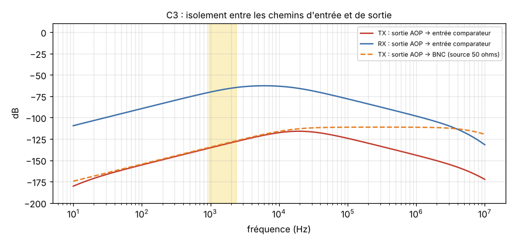
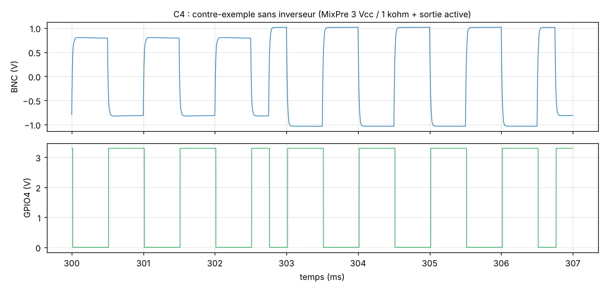

## 4. Circuit d'entrée LTC (mode TX)

### 4.1 Schéma et calcul des valeurs

`BNC → D1 (SMAJ15CA) → SW4 → R1 1 MΩ ↓ → C1 100 nF/100 V → R2 10 kΩ → IN_A [D2 BAT54S vers 0 et 3,3 V, C2 680 pF ↓, R3 100 kΩ vers VMID] → R4 1 kΩ → IN− du TLV3201`, avec IN+ relié à VMID par R7 (10 kΩ) et à la sortie par R8 (470 kΩ).

| Élément | Calcul | Valeur |
|---|---|---|
| R2 | limite le courant d'écrêtage à (9 V − 3,6 V) / 10 kΩ = 0,54 mA pour 18 Vcc ; fixe Zin ≥ 10 kΩ même en écrêtage | 10 kΩ |
| R3, VMID | polarisation à VCC/2 ; VMID = 2 × 47 kΩ, découplé par 10 µF (Thévenin 23,5 kΩ, sans effet en alternatif) | 100 kΩ |
| C1 | passe-haut 1 / (2π (R2+R3) C1) = 14,5 Hz : laisse passer 960 Hz avec moins de 5 % d'inclinaison sur un bit, coupe le continu (100 V) | 100 nF |
| C2 | passe-bas 1 / (2π (R2‖R3) C2) = 25,7 kHz : 10 fois au-dessus des harmoniques utiles, coupe la HF et les parasites radio ; retard ajouté ≈ 6 µs | 680 pF C0G |
| R4 | second étage de limitation : protège l'entrée du TLV3201 (max. absolu ±10 mA) | 1 kΩ |
| R7/R8 | hystérésis ± 3,3 V × R7 / (R7+R8) / 2 = **±34 mV** au comparateur, soit ±38 mV ramenés à la BNC (gain 0,90) | 10 kΩ / 470 kΩ |
| R9 | limite le courant si la GPIO est configurée en sortie par erreur | 100 Ω |
| D1 | TVS bidirectionnelle : VRWM 15 V > 9 V crête du signal Sony maximal ; VBR 16,7 V min ; écrête les DES et les surtensions | SMAJ15CA |

**Comparateur** : TLV3201 (TI). Alimentation de 2,7 à 5,5 V, mode commun de VEE − 0,2 V à VCC + 0,2 V, temps de propagation 47 ns, sortie push-pull (VOL 230 mV à 4 mA sous 2,7 V), offset 3 mV max, 40 µA. Les niveaux de sortie sont directement compatibles avec les seuils de l'ESP32 (VIH = 0,75 VDD, VIL = 0,25 VDD). La sortie est inversée, ce qui est sans importance puisque le biphase-mark ne dépend pas de la polarité.

L'impédance d'entrée simulée est de **82 kΩ à 1 kHz, 52 kΩ à 2,4 kHz et 8,6 kΩ à 20 kHz** (effet de C2). La bande passante va de 15 Hz à 25 kHz.

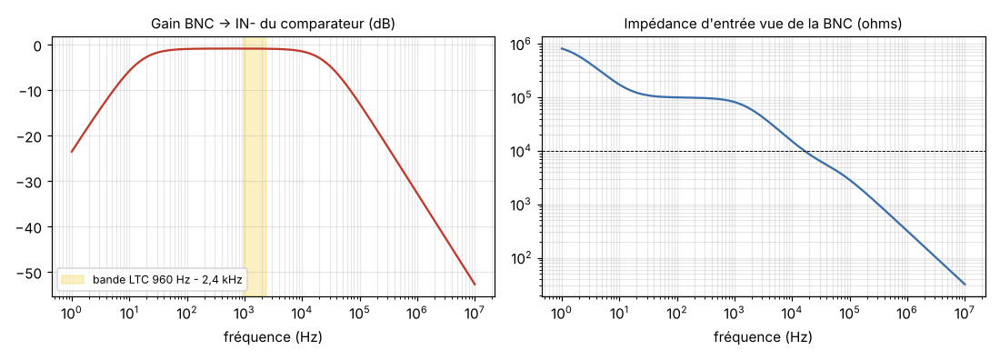

### 4.2 Simulation A

On génère un vrai LTC (trames complètes, BCD, mot de synchro, bit de polarité, drop-frame) avec `sim/ltc/ltc.py`, puis on décode la sortie du comparateur avec l'algorithme du firmware. **Un cas n'est déclaré réussi que si chaque image décodée porte exactement le timecode émis**, dans l'ordre.

| Cas | Signal | Images valides | Retard moyen / gigue crête-crête | Courant d'écrêtage max | IN− min / max |
|---|---|---|---|---|---|
| A1 | Sony 1 Vcc / 50 Ω, 25 i/s | 4/4 | 6,9 / 1,0 µs | 0,03 mA | 1,14 / 2,47 V |
| A2 | 0,3 Vcc / 1 kΩ, 30 i/s, bruit 10 mV rms + 50 Hz 50 mVcc | 4/4 | 11,5 / 6,6 µs | 0,01 mA | 1,43 / 1,85 V |
| A3 | 18 Vcc / 50 Ω, 24 i/s | 4/4 | 2,4 / 4,6 µs | 1,56 mA | −0,32 / 3,64 V |
| A4 | MixPre 3 Vcc / 1 kΩ, 29,97 DF | 4/4 (10:09:59;28 → 10:10:00;01) | 7,6 / 1,0 µs | 0,09 mA | 0,24 / 3,53 V |
| A5 | fronts de 60 µs (hors norme), 0,5 Vcc | 4/4 | 13,7 / 5,1 µs | 0,01 mA | 1,36 / 2,02 V |
| A6 | carré à fronts de 1 µs, 2 Vcc | 4/4 | 4,4 / 0,8 µs | 0,18 mA | 0,69 / 3,37 V |
| A7 | 1 Vcc + 5 V de composante continue | 4/4 | 6,9 / 1,1 µs | 0,03 mA | 1,14 / 2,47 V |

Les bornes d'IN− restent dans les maxima absolus du TLV3201 (−0,5 V à VCC + 0,5 V = 3,8 V). Le retard de 2 à 14 µs est négligeable devant un demi-bit (208 µs) et identique sur les deux fronts, donc sans distorsion. La gigue crête-crête, de 0,8 à 6,6 µs, correspond au pire cas bruité. La première image après le branchement sert à l'acquisition : C1 se recentre avec τ = 11 ms.

**Seuil** : avec l'offset maximal de la fiche (±3 mV), le décodage tient jusqu'à **0,09 Vcc**, soit une marge de 3,3 fois sous le minimum du MixPre et de 5,5 fois sous celui des Sony.

**Défauts (A9)** : branchement à chaud d'une source de 12 V continue sur 50 Ω, sinusoïde de 30 Vcc, pointe de 24 V pendant 1 ms. IN− reste entre −0,34 et 3,64 V, le courant d'écrêtage ne dépasse pas 1,6 mA et la TVS limite la BNC à 17,5 V. Le courant réinjecté dans +3V3A (1,7 mA au maximum) est absorbé par la consommation de l'ESP32, qui est d'au moins 30 mA.

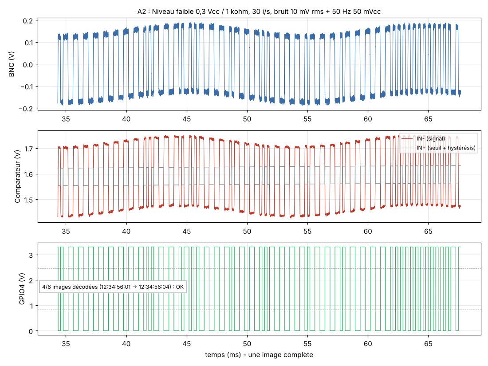
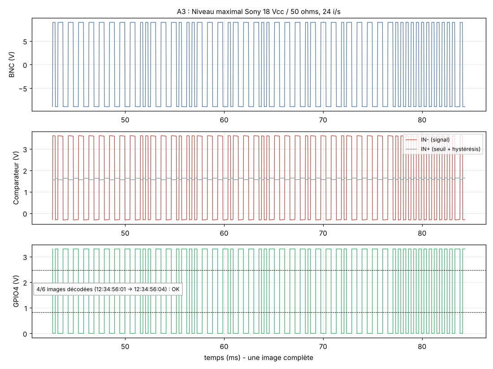
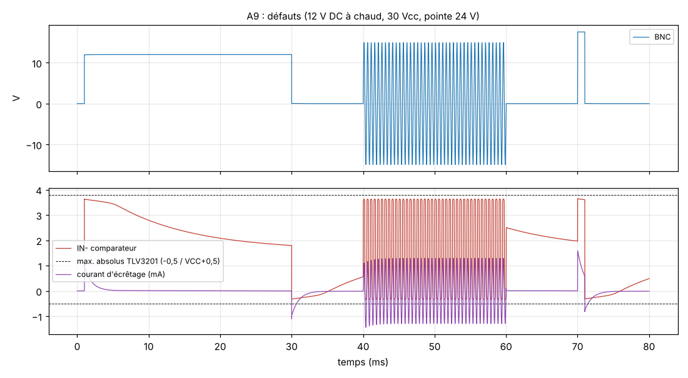

## 5. Circuit de sortie LTC (mode RX)

### 5.1 Schéma et calcul des valeurs

`IO5 → R10 10 kΩ → OUT_SH [R11 30 kΩ vers 3,3 V, R12 30 kΩ vers 0, C5 1,8 nF] → TLV9061 en suiveur → R13 56 Ω → OUT_P [D4 BAT54S] → C7 ‖ C8 (2 × 47 µF) → R14 22 Ω → SW4 → BNC`, avec R15 de 100 kΩ entre la BNC et la masse.

| Élément | Calcul | Valeur |
|---|---|---|
| R10, R11, R12 | Avec R11 = R12 et R10 = 1,65 × Rth : OUT_SH va de 0,66 à 2,64 V, donc **2,0 Vcc centrés sur 1,65 V** ; Rth = 10k ‖ 30k ‖ 30k = 6,0 kΩ | 10 k / 30 k / 30 k |
| C5 | front 10 à 90 % = 2,2 × Rth × C5 = 2,2 × 6 kΩ × 1,8 nF = **23,8 µs** (norme 25 ± 5 µs) | 1,8 nF C0G |
| U4 | TLV9061 : 10 MHz, 6,5 V/µs, sortie à 60 mV des rails sous 2 kΩ, ±50 mA. Sous 75 Ω, le courant crête est de 6,6 mA et la sortie reste entre 0,66 et 2,64 V, loin des rails. | TLV9061 |
| R13 + R14 | Zout = 78 Ω ≈ 75 Ω : 2 Vcc à vide, 1 Vcc sous 75 Ω. R14, côté BNC, limite le courant d'un signal extérieur dans D4. | 56 Ω + 22 Ω |
| C7 ‖ C8 | liaison : 74 µF effectifs (−20 % de tension continue). Avec 75 Ω + 78 Ω, τ = 11 ms, d'où 3,5 % d'inclinaison sur un bit 0. Céramiques non polarisées, qui tolèrent une tension inverse. | 2 × 47 µF X5R |
| R15 | maintient la BNC à 0 V continu quand rien n'est branché | 100 kΩ |

**Règle de firmware tirée de la simulation** : quand aucun LTC n'est généré, IO5 reste **en entrée (haute impédance)**. R11 et R12 centrent alors OUT_SH sur 1,65 V, et C7 ‖ C8 restent chargés à la valeur moyenne du signal. Sans cette règle, le premier essai a montré une composante continue de 0,8 à 0,95 V sur la BNC, décroissant avec τ = 0,7 à 7 s. Elle empêchait le décodage pendant plusieurs secondes sur les charges de haute impédance.

### 5.2 Simulation B

| Cas | Charge | Vcc à l'équipement | Front montée / descente | Inclinaison | Images | Courant AOP crête |
|---|---|---|---|---|---|---|
| B1 | Sony TC IN 10 kΩ + 10 m RG-59 | 1,96 V | 23,9 / 23,9 µs | 0,03 % | 5/5 | 0,13 mA |
| B2 | 75 Ω | **0,98 V** | 23,5 / 23,5 µs | 3,5 % | 5/5 | 6,6 mA |
| B3 | MixPre 20 kΩ, 30 i/s | 1,97 V | 24,0 / 24,0 µs | 0,26 % | 5/5 | 0,06 mA |
| B4 | à vide (1 MΩ), 24 i/s | 1,98 V | 24,0 / 23,5 µs | 0,06 % | 5/5 | 0,09 mA |
| B5 | 600 Ω, 29,97 DF | 1,75 V | 23,5 / 23,5 µs | 0,4 % | 5/5 | 1,5 mA |
| B6 | 10 kΩ au bout de 100 m (6,7 nF) | 1,96 V | 24,0 / 24,0 µs | 0,95 % | 5/5 | 1,0 mA |

L'impédance de sortie déduite des cas à vide et sous 75 Ω est de **75,7 Ω**. La composante continue reste sous 11 mV dans tous les cas.

- **B7, court-circuit franc sur la BNC** : 13,2 mA dans l'AOP et 8,5 mW dans R13. C'est permanent et sans dommage.
- **B8, sortie MixPre (3 Vcc / 1 kΩ) branchée en opposition** : 2,3 mA crête, et OUT_P reste dans les rails.
- **B9, boucle complète** : sortie d'un boîtier RX, 10 m de RG-59, puis entrée d'un boîtier TX. 5/5 images décodées, retard de bout en bout 14,4 µs, gigue 1,3 µs.

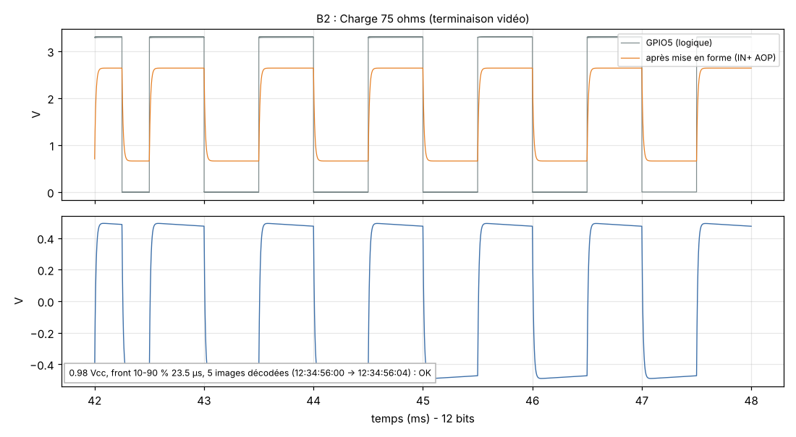
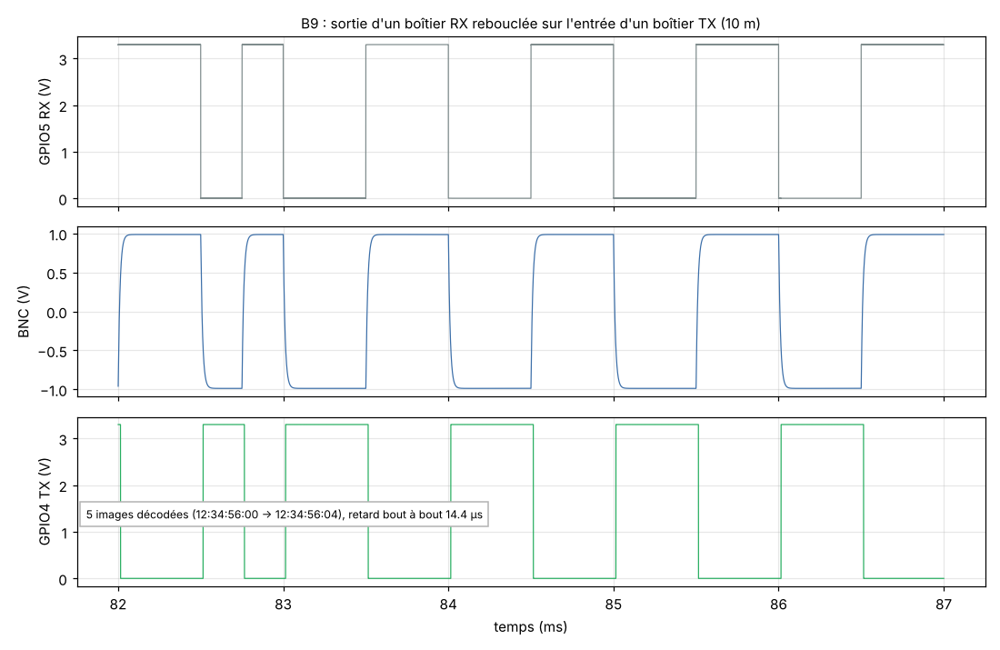

### 5.3 Pourquoi pas un transistor BC547 ?

Un émetteur suiveur NPN alimenté en 3,3 V ne peut que fournir du courant. Pour descendre de 0,5 V dans 75 Ω, il faudrait une résistance d'émetteur qui absorbe 7 mA en permanence (classe A), d'où environ 20 mW perdus. La sortie serait alors asymétrique (Zout différente sur les fronts montants et descendants) et la tension de base-émetteur (0,6 V) réduirait l'excursion. Le TLV9061 coûte 0,35 €, consomme 0,54 mA et donne une sortie symétrique de 76 Ω. Une simple GPIO derrière une résistance donnerait des fronts de 5 ns, donc hors norme et riches en diaphonie, et elle ne tiendrait pas une charge de 75 Ω sans s'effondrer.

### 5.4 Compatibilité attendue

| Équipement | Niveau reçu | Marge | Commentaire |
|---|---|---|---|
| Sony TC IN (0,5 à 18 Vcc, 10 kΩ) | 1,96 Vcc | × 3,9 au-dessus du minimum | à confirmer sur FX6/FS5/Z150/Z200 |
| MixPre-3/6 II Aux In (0,3 à 3,0 Vcc, 20 kΩ) | 1,97 Vcc | sous le maximum de 3,0 Vcc | câble BNC vers jack 3,5 mm TRS : âme sur la pointe (à vérifier dans le manuel MixPre) |
| FX3 + VMC-BNCM1 | 1,96 Vcc (impédance non publiée) | – | entrée seulement : le FX3 ne peut être que récepteur |
| Pocket 6K Pro (entrée micro) | à atténuer | – | voir 5.5 |

### 5.5 Câble pour la Pocket 6K Pro (externe au boîtier)

L'entrée 3,5 mm est une entrée micro. Un atténuateur passif d'environ −30 dB, monté dans le câble BNC vers jack, ramène les 2 Vcc à environ 60 mVcc. Par exemple une résistance série de 3,3 kΩ et une résistance de 100 Ω en parallèle sur l'entrée, soit un rapport de 1/34. **Valeur à valider avec le réglage de gain de la caméra.** Les fronts de 24 µs facilitent la lecture d'un LTC par une entrée audio.

## 6. Alimentation

### 6.1 Architecture et calculs

- **Charge** : TP4056 (CC/CV 4,2 V ± 1,5 %). Avec RPROG = 3,0 kΩ, le courant de charge est de **400 mA** (table de la fiche). Le choix de 400 mA plutôt que 580 mA est volontaire. Le courant total USB est de 400 mA + 106 mA (système, simulé), soit **506 mA**, ce qui reste dans la limite d'un port USB 2.0. La dissipation du TP4056, (5 − 3,7) × 0,4 = 0,5 W, reste tolérable dans un boîtier imprimé fermé. La charge complète prend environ 6 h. On peut passer à 2,0 kΩ (580 mA, environ 4,3 h) si l'on charge uniquement sur un bloc secteur USB-C. TEMP est relié à la masse, donc il n'y a pas de surveillance thermique de la cellule : choisir une cellule avec PCM intégré.
- **Protection** : DW01A + FS8205A sur le négatif, comme dans le schéma d'application de la fiche (R25 de 470 Ω, C22 de 100 nF, R26 de 2 kΩ). Seuils : surcharge 4,28 V, décharge profonde 2,40 V, surintensité 0,16 V / (2 × 22,5 mΩ) ≈ 3,5 A (2,6 A au pire), court-circuit 1,0 V. La pointe de 500 mA ne produit que 25 mV sur CS, loin du seuil.
- **Chemin d'alimentation** : quand l'USB est présent, D3 (SS14) alimente VSYS à 4,5 V et Q1 (AO3401A) est bloqué. La cellule est alors chargée sans débit parasite, donc la fin de charge à C/10 reste juste. Sans USB, R27 tire la grille de Q1 à la masse. Q1 conduit (60 mΩ max à −4,5 V) et VSYS = VBAT.
- **Marche/arrêt** : SW1 commande l'entrée EN du LDO, sans passer de courant de puissance. À l'arrêt, la consommation est d'environ 25 µA (LDO) + 1,5 µA (DW01A) + 9,5 µA (diviseur VBAT), soit environ 6 ans pour 2000 mAh (estimation).
- **Régulation** : TLV75733P (1 A ; dropout 300 mV typique, 425 mV max à 1 A ; limitation de courant 1,2 A min). La fiche Espressif demande au moins 500 mA à l'alimentation, et le module consomme 355 mA en émission 802.11b à 20,5 dBm. Le régulateur a donc deux fois la marge nécessaire. Découplage : 10 µF en entrée, 22 µF + 22 µF + 100 nF côté module (schéma de référence Espressif), 47 µF sur VSYS.
- **Rail analogique** : +3V3A est séparé par une ferrite BLM18PG221SN1 et découplé par 10 µF + 100 nF. Il alimente le comparateur, l'AOP et VMID. Au routage, la masse analogique (BNC, entrée, sortie) rejoint la masse générale en un seul point près de U4.

### 6.2 Simulation D

Charge : réception permanente de 95 mA, émission de 355 mA pendant 1 ms à chaque image, plus une pointe de 500 mA pendant 2 ms.

| f.é.m. batterie | Dropout | 3V3 min (500 mA) | 3V3 min (émissions) | VSYS min | ≥ 3,0 V |
|---|---|---|---|---|---|
| 4,20 V | typique | 3,269 V | 3,278 V | 4,08 V | oui |
| 3,70 V | typique | 3,269 V | 3,278 V | 3,58 V | oui |
| 3,45 V | typique | 3,175 V | 3,253 V | 3,33 V | oui |
| 3,30 V | typique | 3,023 V | 3,101 V | 3,17 V | oui |
| 3,20 V | typique | 2,921 V | 3,000 V | 3,07 V | **non** |
| 3,40 V | maximal | 3,062 V | 3,157 V | 3,28 V | oui |
| 3,30 V | maximal | 2,960 V | 3,056 V | 3,17 V | **non** |
| USB 5,0 V | – | 3,269 V | 3,278 V | 4,53 V | oui (106 mA sur l'USB) |
| USB 4,75 V, batterie vide | – | 3,269 V | 3,278 V | 4,28 V | oui |

**Tension de coupure** : f.é.m. de 3,3 V (régulateur typique) à 3,4 V (régulateur au pire). Sur une courbe LiPo générique, il reste alors 2 à 4 % de la capacité, donc presque toute la batterie est utilisable. Le firmware mesure VBAT sur IO1 et doit signaler la batterie faible à 3,5 V, puis s'arrêter proprement à 3,35 V sous charge.

**Autonomie estimée** (2000 mAh nominaux, courbe générique) :

| Mode | Courant moyen | Autonomie (cellule neuve) | Cellule à 80 % |
|---|---|---|---|
| TX : un paquet par image | 106 mA | **18,5 h** | 14,5 h |
| RX : écoute permanente | 100 mA | **19,7 h** | 15,4 h |
| RX avec fenêtre d'écoute ESP-NOW de 10 % (option logicielle) | 50 mA | 39 h | 31 h |

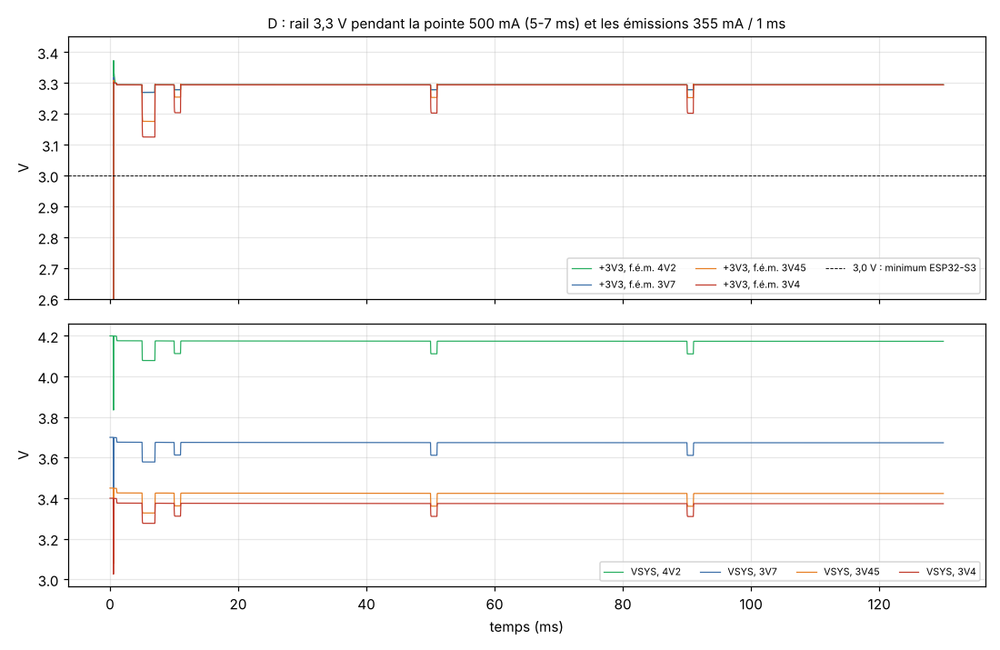

## 7. Synchronisation radio et horloge du RX (simulation E, comportementale)

Le RX horodate l'arrivée de chaque paquet avec son horloge locale. Comme la gigue radio ne peut qu'**ajouter** du retard, il retient le **minimum** des écarts sur une seconde, ce qui rejette la gigue. Une boucle PI corrige alors la fréquence (intégrale) et la phase (proportionnelle). La correction de phase est étalée et bornée à ±200 ppm, si bien que **le timecode ne saute jamais**. Pendant une coupure de plus de 2 s, le RX passe en maintien sur la fréquence moyenne des 60 dernières secondes.

Hypothèses (toutes à mesurer) : latence fixe de 1,2 ms, étalonnée à 1,1 ms (100 µs d'erreur volontaire) ; gigue exponentielle de 0,4 ms en moyenne ; 5 % de paquets retardés jusqu'à 4 ms ; 10 % de pertes ; coupure totale de 30 s ; quartz du RX à +18 ppm, dérivant de +1 ppm pendant la coupure.

| Grandeur | Résultat |
|---|---|
| Verrouillage | 1,0 s après le premier paquet |
| Écart verrouillé (moyenne, écart type, max) | 117 µs, 13 µs, 164 µs (0,4 % d'une image à 25 i/s) |
| Pendant la coupure de 30 s | 200 µs au maximum |
| Après la coupure | 160 µs au maximum, sans saut |
| Durée d'image générée | de 39,991 à 40,009 ms : **aucune image sautée ou dupliquée** |

L'écart moyen de 117 µs vient presque entièrement de l'erreur d'étalonnage de la latence. Celle-ci se mesure une fois pour toutes à l'oscilloscope, en comparant le LTC d'entrée du TX et le LTC de sortie du RX. En maintien de longue durée, avec 1 ppm d'erreur résiduelle, la dérive reste de 3,6 ms par heure, soit moins d'une image en 10 h.

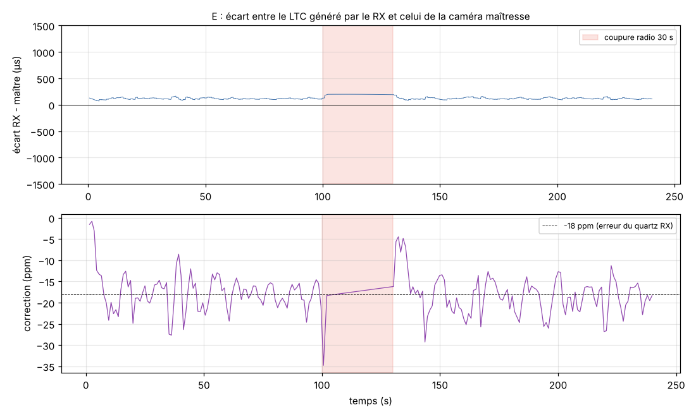

## 8. Schéma complet, affectation des GPIO, nomenclature

- Schéma KiCad 7 : [`kicad/boitier-ltc.kicad_sch`](../kicad/boitier-ltc.kicad_sch) (exports [`boitier-ltc.pdf`](../kicad/boitier-ltc.pdf), [`boitier-ltc.png`](../kicad/boitier-ltc.png), netlist [`boitier-ltc.net`](../kicad/boitier-ltc.net)). Les symboles TLV3201, TP4056, DW01A et FS8205A sont dans `kicad/boitier_ltc.kicad_sym`. Les autres viennent des bibliothèques standard de KiCad.
- **Cohérence vérifiée** : `kicad/gen/check_netlist.py` compare la netlist exportée par KiCad à celle de `design.py`, qui sert aussi à générer les netlists ngspice. Résultat : 53 nets identiques.

| GPIO | Fonction | GPIO | Fonction |
|---|---|---|---|
| IO4 | LTC_RX_GPIO, sortie comparateur (capture MCPWM) | IO7 | LED TX (rouge) |
| IO5 | LTC_TX_GPIO, LTC généré (haute impédance au repos) | IO15 | LED RX (jaune) |
| IO6 | MODE, pôle B de SW4 (0 = TX) | IO16 | LED SYNC (verte) |
| IO1 | VBAT / 2 (ADC1) | IO17 | LED marche / batterie faible |
| IO2 | VBUS / 2 (détection USB) | IO19 / IO20 | USB natif D− / D+ |
| IO0 | BOOT | EN | RESET (RC 10 kΩ / 1 µF) |

**Nomenclature** : [`docs/BOM.md`](BOM.md) et [`docs/BOM.csv`](BOM.csv). Elle compte 53 lignes, cellule, PCB et boîtier compris. **Coût estimé : 23,4 € par boîtier hors port**, soit environ 30 € avec le port pour une petite série de 5 à 10. Les postes principaux sont l'ESP32-S3 (3,60 €), la BNC (environ 3 €), la cellule (environ 7 €) et le PCB (environ 3 €). Les passifs, LED et inverseurs récupérables à l'école en déduisent environ 2 €.

**Encombrement** : module de 18 × 25,5 mm, cellule 803860 (8 × 38 × 60 mm), BNC de panneau (corps d'environ 12 mm de diamètre), PCB d'environ 62 × 36 mm posé au-dessus de la cellule. Cela donne un boîtier d'environ **72 × 42 × 26 mm**, proche de la cible. L'antenne PCB doit dépasser du côté opposé à la BNC et à la cellule, avec la zone de dégagement de la fiche Espressif.

## 9. Limites des simulations et hypothèses non vérifiées

1. **Modèles comportementaux** : les modèles PSpice de TI n'ont pas pu être téléchargés depuis l'environnement. Le TLV3201, le TLV9061 et le TLV75733P sont donc des macro-modèles calés sur les valeurs des fiches (`sim/models/composants.lib`). Le TLV3201 néglige son hystérésis interne de 1,2 mV (pessimiste). Le TLV9061 n'a qu'un pôle, donc sa stabilité sur charge capacitive n'est pas évaluée ; R13 l'isole du câble. La réponse transitoire du LDO utilise un pôle de 200 kHz supposé, la fiche ne donnant qu'une courbe.
2. **Diodes** : le BAT54 est ajusté sur les VF maximaux de la fiche ST. La capacité de la SMAJ15CA (500 pF) et la courbe de la SS14 à 100 mA sont supposées.
3. **Batterie** : Rint de 120 mΩ et courbe f.é.m./état de charge génériques. À remplacer par la fiche de la cellule achetée. Une Rint plus élevée (froid, vieillissement) remonte la tension de coupure.
4. **ESP32** : la consommation provient des valeurs crêtes de la fiche. La pointe de 500 mA représente un pire cas supposé, pas une mesure. La radio et le firmware ne sont pas simulés électriquement.
5. **Synchronisation** : la latence, la gigue et les pertes d'ESP-NOW sont des **hypothèses**. L'algorithme simulé est celui que devra implémenter le firmware, mais ce firmware n'existe pas encore.
6. **Niveaux Sony** : ils ont été relevés sur la PXW-Z450 et la PMW-150, pas sur la FX6, la FS5, la Z150 ni la Z200, dont les fiches publiques ne les donnent pas.
7. **Non simulés** : décharges électrostatiques (IEC 61000-4-2), CEM, effets de routage, rebonds mécaniques de l'inverseur, comportement thermique du TP4056 dans le boîtier.

## 10. Essais obligatoires sur matériel avant de lancer le PCB

1. **Entrée** : maquette du circuit d'entrée sur plaque d'essai, en lisant le TC OUT d'une FX6 et d'un MixPre. Vérifier à l'oscilloscope le niveau réel et le décodage sur au moins 10 minutes, en 25 et 29,97 DF.
2. **Sortie** : vérifier que chaque caméra (FX6, Z200, FS5, Z150, FX3 avec VMC-BNCM1) et le MixPre **verrouille** sur le LTC du boîtier, en lecture continue et en jam. Vérifier l'indicateur EXT-LK des Sony et mesurer l'amplitude réellement reçue.
3. **Pocket 6K Pro** : ajuster l'atténuateur et le gain de l'entrée micro.
4. **Radio** : mesurer avec deux ESP32-S3 la latence et la gigue d'ESP-NOW, LTC d'entrée et de sortie sur deux voies d'oscilloscope, en intérieur et en extérieur, à 10, 50 et 100 m, et avec du Wi-Fi ambiant. Mesurer le taux de pertes et étalonner L0.
5. **Dérive** : laisser un RX en maintien pendant 1 h, radio coupée, et mesurer l'écart.
6. **Alimentation** : mesurer la consommation réelle (TX, RX, arrêt) et la chute de 3V3 au démarrage radio, à 3,4 V de batterie. Vérifier la fin de charge du TP4056 avec le système en marche, et l'échauffement à 400 mA dans le boîtier fermé.
7. **Inverseur** : modèle exact, contacts dorés, course et effort à travers une paroi imprimée. Vérifier qu'il coupe avant de fermer.
8. **Antenne** : portée avec le module dans le boîtier en PETG, la cellule et la BNC à leur place définitive.
9. **DES** : décharges de 8 kV au contact sur la BNC, en marche, une fois la TVS en place.

## 11. Composants et points d'attention

- **TP4056 et DW01A/FS8205A** : composants chinois très courants (LCSC). Il existe des secondes sources (UMW, Slkor, JSMSEMI), mais vérifier la fiche du fabricant réellement acheté.
- **Inverseur 2P2T à glissière à contacts dorés, monté en façade** : la référence donnée (C&K JS202011JCQN) est **à confirmer en stock**. L'E-Switch EG2208 est une alternative traversante.
- **BNC femelle 75 Ω de panneau** : la vraie 75 Ω coûte de 3 à 8 €. À 2,4 kHz, une 50 Ω conviendrait électriquement, mais elle n'est pas compatible mécaniquement à 100 % avec certaines fiches 75 Ω.
- **47 µF X5R en 1206** : prévoir une perte de capacité de 20 à 30 % sous la tension continue (prise en compte dans la simulation, 37 µF chacun).

## 12. Le boîtier dans l'Établi (émulateur du projet)

L'Établi a reçu une analyse transitoire (intégration trapézoïdale, comme le `.tran` de ngspice), un condensateur, un générateur de signaux et de timecode LTC, le comparateur TLV3201, l'ampli op TLV9061, la diode BAT54 et un oscilloscope deux voies avec décodeur LTC. Le menu **Montages** charge le circuit d'entrée (mode TX) et le circuit de sortie (mode RX) avec les valeurs de `design.py`. On peut y changer l'amplitude et l'impédance de la source, la cadence ou la charge, puis relancer l'analyse.

Les deux montages ont été comparés aux simulations ngspice de ce dossier (`tests/transient.test.mjs`) :

| Cas | Établi | ngspice |
|---|---|---|
| A1 : 1 Vcc / 50 Ω, 25 i/s | 4 images exactes, retard 7,9 µs, IN− min 1,13 V | 4 images, 6,9 µs, 1,14 V |
| A3 : 18 Vcc / 50 Ω, 24 i/s | 4 images, retard 3,3 µs, IN− min −0,32 V | 4 images, 2,4 µs, −0,32 V |
| A4 : 3 Vcc / 1 kΩ, 29,97 DF | 4 images, retard 8,3 µs, IN− min 0,22 V | 4 images, 7,6 µs, 0,24 V |
| B2 : charge 75 Ω | 0,984 Vcc, fronts 23,8 / 23,6 µs | 0,984 Vcc, 23,5 / 23,5 µs |
| B4 : à vide | 1,977 Vcc, fronts 23,7 / 23,7 µs | 1,977 Vcc, 24,0 / 23,5 µs |
| B5 : 600 Ω, 29,97 DF | 1,754 Vcc, fronts 23,7 / 23,7 µs | 1,753 Vcc, 23,5 / 23,5 µs |

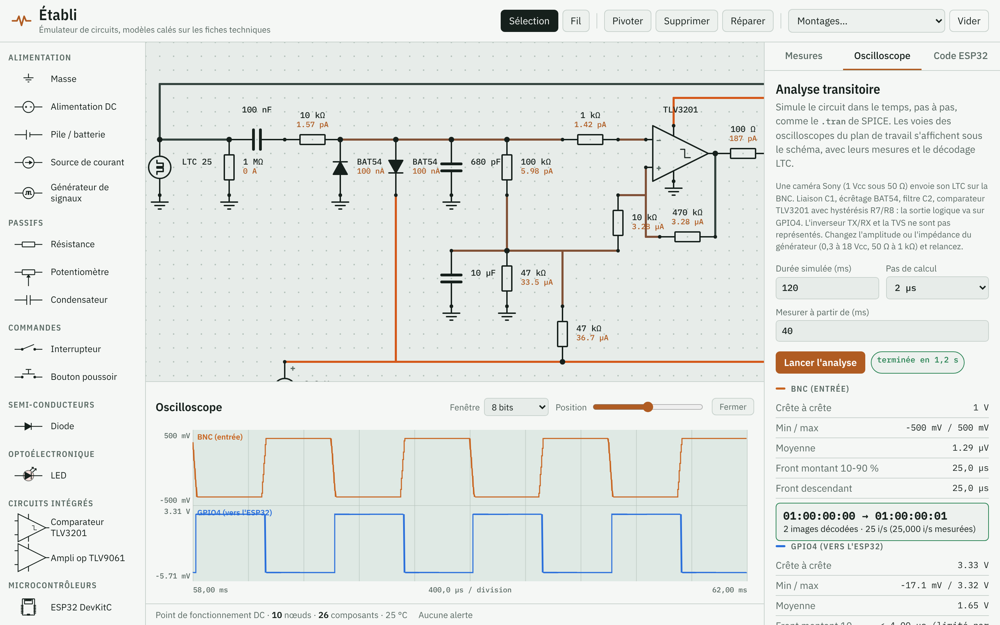

Le retard supplémentaire d'environ 1 µs vient du modèle du comparateur dans l'Établi, qui bascule un pas de calcul après son entrée. Les deux outils partagent les mêmes hypothèses de modèles (§9). Leur accord confirme les calculs, pas le comportement du vrai matériel.

## 13. Fichiers et reproduction

```
timecode-ltc/
  design.py                  source unique : composants, nets, SPICE, prix
  kicad/                     projet KiCad 7 (schéma, PDF, PNG, netlist, symboles)
  kicad/gen/                 générateur du schéma et contrôle de cohérence
  sim/models/composants.lib  modèles ngspice commentés (sources des paramètres)
  sim/gen/*.inc              sous-circuits générés depuis design.py
  sim/A_entree ... D_alim    bancs ngspice (.cir lisibles et relançables) + resultats.json
  sim/E_synchro              modèle comportemental de la synchronisation
  sim/ltc/ltc.py             codeur/décodeur LTC (toutes cadences, drop-frame)
  docs/RAPPORT.md, BOM.md, BOM.csv, figures/
  run_all.sh                 régénère tout
```

Pour tout relancer : `./run_all.sh` (il faut ngspice 42, KiCad 7, Python 3 avec numpy et matplotlib). Chaque `.cir` peut aussi être relancé seul avec `ngspice -b X.cir`.
